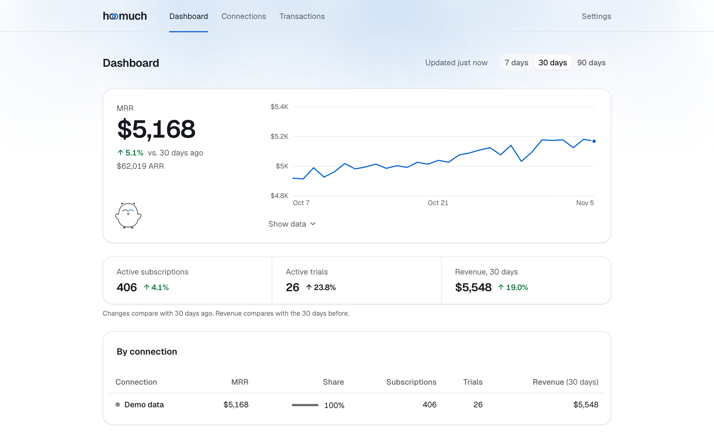

<p align="center">
  <picture>
    <source media="(prefers-color-scheme: dark)" srcset="public/mascot/perched-dark.png">
    
  </picture>
</p>

<h1 align="center">hoomuch</h1>

<p align="center">
  All your subscription revenue under one roof. Self-hosted, read-only, open source.
</p>

<p align="center">
  <a href="https://github.com/tahabozdemir/hoomuch/actions/workflows/ci.yml"></a>
  <a href="LICENSE"></a>
</p>

<p align="center">
  <a href="#deploy-to-cloudflare">Deploy</a> ·
  <a href="#connecting-providers">Providers</a> ·
  <a href="#known-limitations">Known limitations</a> ·
  <a href="CONTRIBUTING.md">Contributing</a> ·
  <a href="SPEC.md">Spec</a>
</p>

hoomuch connects to the billing providers you already use and puts the numbers on one dashboard:
total MRR and ARR, active subscriptions, trials and revenue, converted into one currency and broken
down by connection.

<picture>
  <source media="(prefers-color-scheme: dark)" srcset=".github/assets/dashboard-dark.png">
  
</picture>

- **Twelve providers.** Stripe, Paddle, Lemon Squeezy, Polar, RevenueCat, Chargebee, Dodo Payments,
  Gumroad, Adapty, Superwall, App Store Connect and Google Play.
- **Read-only.** hoomuch never writes to a provider, and asks for read-only keys wherever the provider
  offers them.
- **Your keys stay on your account.** It runs on your own Cloudflare account, and provider keys are
  encrypted at rest (AES-256-GCM).
- **No customer personal data.** It keeps amounts, currencies, timestamps, IDs and plan names, never
  your customers' emails, names or addresses.
- **Try it without a key.** After signing up, **Try demo data** fills the dashboard with a sample
  business.

## Deploy to Cloudflare

[](https://deploy.workers.cloudflare.com/?url=https://github.com/tahabozdemir/hoomuch)

### One click

Click **Deploy to Cloudflare** above. Cloudflare copies this repo into your GitHub or GitLab account,
creates the D1 database and the sync queue, and asks for `ENCRYPTION_KEY` (generate one with
`openssl rand -base64 32`). Every deploy applies pending D1 migrations first, and every push to your
copy redeploys it.

### By hand

```bash
npx wrangler login
npx wrangler d1 create hoomuch       # copy the printed database_id into wrangler.jsonc
openssl rand -base64 32 | npx wrangler secret put ENCRYPTION_KEY
npm run deploy                       # applies D1 migrations, then deploys
```

The first deploy also creates the `hoomuch-sync` queue that every sync runs on.

Queues are on the Free plan too, with 10,000 operations a day. Each sync is about three
operations, so that's roughly 3,300 syncs a day: around 130 connections at the default hourly
interval.

### After deploying

- **Back up `ENCRYPTION_KEY`.** If it's lost, every stored provider key becomes unreadable and each
  connection has to be re-keyed. Never rotate it in place.
- **Close sign-ups.** Create your account, then set `"ALLOW_SIGNUP": "false"` in `wrangler.jsonc` and
  deploy again (with the button, commit that change to your copy of the repo).
- **Use Workers Paid for production.** Password hashing (PBKDF2, 100k iterations) and syncs can exceed
  the Free plan's 10 ms CPU limit.

## Configuration

| Name | Where | Default | What it does |
|------|-------|---------|--------------|
| `ENCRYPTION_KEY` | Secret (`wrangler secret put`) | none, required | 32 random bytes, base64. Encrypts provider keys at rest. |
| `ALLOW_SIGNUP` | `vars` in `wrangler.jsonc` | `"true"` | Set to `"false"` once your own account exists, so nobody else can sign up. |
| `SYNC_INTERVAL_MINUTES` | `vars` in `wrangler.jsonc` | `"60"` | How often each connection syncs, rounded up to a multiple of the 30-minute cron. |
| `TURNSTILE_SITE_KEY` | `vars` in `wrangler.jsonc` | `""` (off) | Optional. A [Turnstile](https://developers.cloudflare.com/turnstile/) widget's site key. With the secret below, log in and sign up require the Turnstile check. |
| `TURNSTILE_SECRET_KEY` | Secret (`wrangler secret put`) | none | Optional. The same widget's secret key. |
| `RESEND_API_KEY` | Secret (`wrangler secret put`) | none (off) | Optional. A [Resend](https://resend.com) API key with sending access. When set, sign-up mails a confirmation link and new accounts can't use hoomuch until it's clicked (see below). |
| `MAIL_FROM` | `vars` in `wrangler.jsonc` | `""` | Sender of that email, on a domain verified in Resend, e.g. `hoomuch <hello@example.com>`. Needed once `RESEND_API_KEY` is set. |
| `RL_REQUESTS`, `RL_AUTH` | `ratelimits` in `wrangler.jsonc` | 300 and 10 a minute | Per-network request limits (see below). `namespace_id` must be unique in your Cloudflare account. |
| `SYNC_QUEUE` | `queues` in `wrangler.jsonc` | queue `hoomuch-sync` | Required. Every sync runs in this queue's consumer, one connection at a time per invocation (up to 10 at once). `wrangler deploy` creates the queue if it's missing. |

The cron schedule itself is `triggers.crons` in `wrangler.jsonc`. Each tick puts the connections that
are due on the queue.

### Protecting a public instance

If you keep sign-ups open, hoomuch defends itself in layers. Each one is cheap, and each catches what
the one before lets through:

- **Request limits** (`RL_REQUESTS`, `RL_AUTH`): Cloudflare's Rate Limiting binding turns a flood
  away per network (IPv6 by /64) before the Worker touches D1. Every request counts against 300 a
  minute; log-in and sign-up submissions against 10 a minute.
- **Exact limits in D1**, each counted before the password hash: log-in attempts per email and
  network, per account, and per network across all emails (30 every 15 minutes, which stops
  credential stuffing), plus 5 new accounts per network a day.
- **No throwaway inboxes.** Sign-ups from the
  [disposable-email-domains](https://github.com/disposable-email-domains/disposable-email-domains)
  list (CC0) are refused, subdomains included. The list is vendored, so there's no lookup at runtime;
  `npm run domains:update` refreshes it.
- **A honeypot field** on both forms that people never see, so bots that fill every input give
  themselves away. It needs no JavaScript.
- **Email verification**, if you set `RESEND_API_KEY` and `MAIL_FROM`. Without it, anyone can sign
  up with an address they don't own. With it, a new account is held at a "check your inbox" page
  until the person opens the link mailed to them. The link works once and expires after 24 hours,
  and "Send the link again" is limited to 3 every 15 minutes and 10 a day per account. An account
  nobody confirms is removed once all its links have expired, so the address is free for its real
  owner. Accounts from before this feature (migration `0004`) count as confirmed; ones created later
  while mail was off are asked to confirm the next time they're used. Verify your sending domain in
  Resend and turn its click tracking off, so links reach people unchanged.
- **Turnstile**, if you set both keys. Create a widget in the Cloudflare dashboard (Managed mode,
  your hostname), put the site key in `vars` and `wrangler secret put TURNSTILE_SECRET_KEY`. Log in and
  sign up then need JavaScript, and only those two pages allow `challenges.cloudflare.com` in their
  CSP. For local testing, Cloudflare's test pair (`1x00000000000000000000AA` /
  `1x0000000000000000000000000000000AA`) passes on any host.

Cloudflare blocks network-level DDoS on its own. Its WAF and Bot Fight Mode only see traffic on your
own domain, though, not on `*.workers.dev`. For a public instance, add a custom domain and set
`"workers_dev": false` in `wrangler.jsonc`, so nobody can go around them.

## Connecting providers

| Provider | Key | Permissions |
|----------|-----|-------------|
| Stripe | Restricted key `rk_live_…` | Read: Subscriptions, Prices, Balance; Coupons is optional and takes discounts off MRR; Products is optional and splits MRR by product |
| Paddle | API key `pdl_live_apikey_…` (expires; one year at most) | Read: Subscriptions, Transactions, Adjustments, Metrics; Discounts optional |
| Lemon Squeezy | API key (can't be scoped, so it has full access) | — |
| Polar | Organization access token `polar_oat_…` | `metrics:read`, `subscriptions:read`, `orders:read`, `refunds:read` |
| RevenueCat | v2 secret key `sk_…` + Project ID | `charts_metrics:overview:read`; `charts_metrics:charts:read` is optional and enables daily revenue history |
| Chargebee | Read-only API key + site name | Read-only key (All, or Restricted with transactional data) |
| Dodo Payments | API key `dodo_live_…` | Read: Subscriptions, Balances |
| Gumroad | Access token from your own Gumroad application (can't be scoped, so it has full access) | — |
| Adapty | Secret API key `secret_live_…` (can't be scoped) | — |
| Superwall | Organization API key + Organization ID | `charts:read`; `data:read` is optional and enables daily revenue, refunds and trials |
| App Store Connect | Team API key (`.p8` file) + Issuer ID, Key ID and vendor number | Sales role (Finance or Admin also work, but can do more). Individual keys can't read sales reports |
| Google Play | Service account JSON key + the reports bucket's Cloud Storage URI | Play Console: View app information and download bulk reports; View financial data. The Google Play Android Developer API turned on in the service account's project |

Keys are checked live before they're saved. The first sync backfills 90 days of revenue. After that,
each connection syncs every `SYNC_INTERVAL_MINUTES` (an hour by default), and **Sync now** runs one
straight away.

## Updating

Pull the latest changes from this repository into your copy and deploy (with the button, pushing to
your copy redeploys it). Every deploy applies pending D1 migrations first. Some migrations rebuild a
table (`0003` does, to accept new provider ids), so note a restore point before you update:

```bash
npx wrangler d1 time-travel info hoomuch
```

If anything looks wrong afterwards, put the database back:

```bash
npx wrangler d1 time-travel restore hoomuch --timestamp=<that time>
```

Changes that affect data you've already synced:

- **Sales tax.** Revenue from merchant-of-record providers now leaves out sales tax. Lemon Squeezy
  history synced before this change and older than about 30 days keeps tax in; delete and re-add the
  connection to recount it.
- **Currency units.** Amounts follow ISO 4217 minor units, so HUF, IDR, COP and PKR count in
  hundredths. They used to show 100× too large; rows already stored now read correctly without a
  resync. Stripe sends ISK, UGX and MGA in its own units, which are now converted on sync. Rows synced
  before that read 100× off (ISK and UGX too large, MGA too small) until the connection is removed and
  added again.
- **Stripe MRR by product.** The dashboard's **By product** card can now split Stripe MRR by product.
  It needs **Products: Read** on the Stripe key: edit the restricted key in Stripe (⋯ → **Edit key**)
  and the split appears after the next sync. Without it, Stripe syncs as before.

## Known limitations

Each provider's section in [SPEC.md](SPEC.md) §6 lists what was checked against its docs and what
wasn't. The ones you'd notice:

- **Stripe:** customer-level discounts aren't applied, and with Stripe Tax, tax-inclusive prices stay
  tax-inclusive in MRR. Payments carry no product name (reaching one needs read access to invoices and
  charges, which hold customer details), so Stripe is split by product on MRR only, not on revenue.
- **Lemon Squeezy:** refunds issued more than about 30 days after purchase are missed, and several
  partial refunds on one order show as one refund. Its docs don't say which units it uses for
  currencies without two decimals; hoomuch assumes ISO 4217.
- **Paddle and Polar:** MRR is the provider's own figure, in one currency (Paddle: your balance
  currency; Polar: USD). Polar's version pin (`2026-10`) has to be updated before April 2027.
- **RevenueCat, Adapty, Superwall:** daily history is in USD only, revenue is the stores' gross (tax
  and store fees included), and test mode can't be detected.
- **Dodo Payments:** revenue comes from the balance ledger, so it's daily totals with no transaction
  list.
- **App Store Connect:** numbers come from Apple's Sales and Trends reports, so they run a day behind
  (Apple publishes each Pacific Time day the next morning). MRR counts standard-price subscriptions;
  subscribers on a paid introductory or promotional price count as active but not in MRR, because the
  report doesn't say what they pay. Revenue is the customer price, tax included, before Apple's
  commission, in each buyer's currency.
- **Google Play:** Google has no revenue API, so hoomuch reads the reports Play Console exports. MRR
  is Google's active-subscription count priced at each base plan's current price in that country, a
  few days behind; subscribers in a free trial, on an offer or on an older price are counted at that
  price, and trials show as unknown. Revenue comes per order from the estimated sales report (tax
  included, before Google's fee). A newly invited service account can take up to a day to see the
  reports.
- **Gumroad:** MRR is an estimate. The API doesn't say what each subscriber pays, so hoomuch prices
  them at their latest charge, or the tier's list price when it can't find one. Refunds land on the
  sale's day, because Gumroad doesn't date them.
- **Creem** isn't supported yet: its API has no date filter on transactions and no dated refunds
  (SPEC §6.9).
- **Everywhere:** past revenue is converted at today's FX rate, and day boundaries are UTC.
- Provider webhooks are planned for v1.1 (SPEC §12.1).

## How it's built

- One Cloudflare Worker: Hono routes, React 19 pages rendered on the server and hydrated in the
  browser, D1, Cron Triggers.
- UI: [coss ui](https://coss.com/ui) on Base UI, shadcn Charts on Recharts, Lucide icons, Geist Sans
  and Geist Mono, Tailwind CSS 4, Motion where it helps.
- Forms are plain POST forms (Post/Redirect/Get), so every action works before the page hydrates.
  Scripts are same-origin only (CSP `script-src 'self'`). The one exception is opt-in: with Turnstile
  on, the log-in and sign-up pages also load Cloudflare's challenge script.
- Metric definitions and the full product and technical spec are in [SPEC.md](SPEC.md) (in Turkish).

## Development

Requirements: Node 24.14 or later (`.nvmrc` has the version CI and Cloudflare's builds use).

```bash
npm install
cp .dev.vars.example .dev.vars          # then set ENCRYPTION_KEY, e.g. openssl rand -base64 32
npm run db:migrate:local
npm run dev                             # http://localhost:8787
```

[CONTRIBUTING.md](CONTRIBUTING.md) has the rest: running a sync by hand, the npm scripts, the project
layout, the ground rules for pull requests and how to add a provider.

## Security

Please don't open a public issue for a vulnerability. Report it privately through GitHub's
**Security → Report a vulnerability** form on this repository. [SECURITY.md](SECURITY.md) says
what's in scope and what happens next.

## Contributing

Bug reports, fixes and new provider adapters are welcome. Start with
[CONTRIBUTING.md](CONTRIBUTING.md); new providers and new dependencies begin with an issue. Everyone
taking part follows the [code of conduct](CODE_OF_CONDUCT.md).

## License

hoomuch is licensed under the [GNU Affero General Public License v3.0](LICENSE) (AGPL-3.0-only).

You can use, self-host and modify it freely. If you run a **modified** version as a service other
people use, the AGPL requires you to offer those users your modified source code. The footer of every
page links to the source; point it at your fork (`SOURCE_URL` in `src/views/layout.tsx`).
